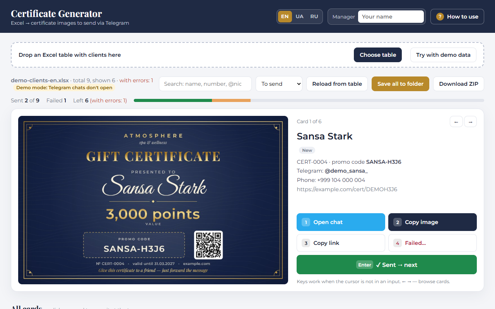

# Certificate Generator — Excel to Telegram

An offline, single-file tool for managers who send gift certificates to clients in Telegram. Drop an Excel table with clients, and the generator renders a personalised certificate image with a QR code for each row, helps send it in Telegram from the keyboard, and writes the status back into the same Excel file.

Screenshots in other languages: [Українська](docs/screenshot-uk.png) · [Русский](docs/screenshot-ru.png)

**Live demo:** [English](https://kolesander-2020.github.io/certificate-generator/?lang=en) · [Українська](https://kolesander-2020.github.io/certificate-generator/?lang=uk) · [Русский](https://kolesander-2020.github.io/certificate-generator/?lang=ru)

Demo tables: [`demo/demo-clients-en.xlsx`](demo/demo-clients-en.xlsx), [`-uk`](demo/demo-clients-uk.xlsx), [`-ru`](demo/demo-clients-ru.xlsx).

## Features

- **Excel in, images out.** Reads the “Clients” sheet with SheetJS, draws each certificate on `<canvas>`: name in script font, value in points, promo code, QR code with the unique link, expiry date.
- **Validation.** Missing or repeated numbers, links and promo codes turn the card pink with the reason; missing contacts give a warning.
- **Fast sending.** Keys `1` open the Telegram chat (by @nick or phone), `2` copy the image, `3` copy the link, `Enter` mark as sent and jump to the next client, `4` mark as failed with a reason.
- **Writes back to Excel.** Status, date, time and manager are written into the same `.xlsx` via the File System Access API — only the needed cells change, formatting stays.
- **Batch export.** Save all certificates to a folder or download a ZIP (.jpg + .txt with the link).
- **Settings in the table.** Theme (navy, emerald, burgundy, light), what to show (promo code / QR), name format, texts, caption template.
- **Three languages.** Interface and certificate texts in English, Ukrainian and Russian (`?lang=en|uk|ru`); column names are recognised in all three.
- **Private by design.** Works fully offline from one HTML file, no data leaves the computer.

## Demo data

The demo tables contain only Game of Thrones characters. Phones use the non-existent `+999` country code, emails and links use the reserved `example.com` domain, and **Demo mode** is switched on in the “Settings” sheet, so the “Open chat” button never opens Telegram. Writing statuses works on your downloaded copy of the table.

## How to run

Open `index.html` in **Google Chrome** or **Microsoft Edge** (double-click or via GitHub Pages) and drop an `.xlsx` table onto the page. Firefox and Safari can render images, but cannot write marks back to the file.

## Stack

HTML, CSS, vanilla JavaScript, Canvas 2D, File System Access API, IndexedDB.
Built with the help of AI coding assistants (Claude Code).

Bundled third-party code (inlined into `index.html`):
[SheetJS Community Edition](https://sheetjs.com/) (Apache-2.0),
[JSZip](https://stuk.github.io/jszip/) (MIT),
[QR Code Generator](https://github.com/kazuhikoarase/qrcode-generator) by Kazuhiko Arase (MIT),
fonts Playfair Display, Great Vibes and Montserrat (SIL Open Font License).

The brand “Atmosphere / Атмосфера” is fictional.
